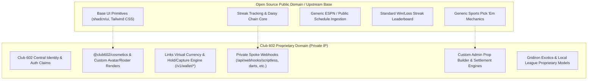
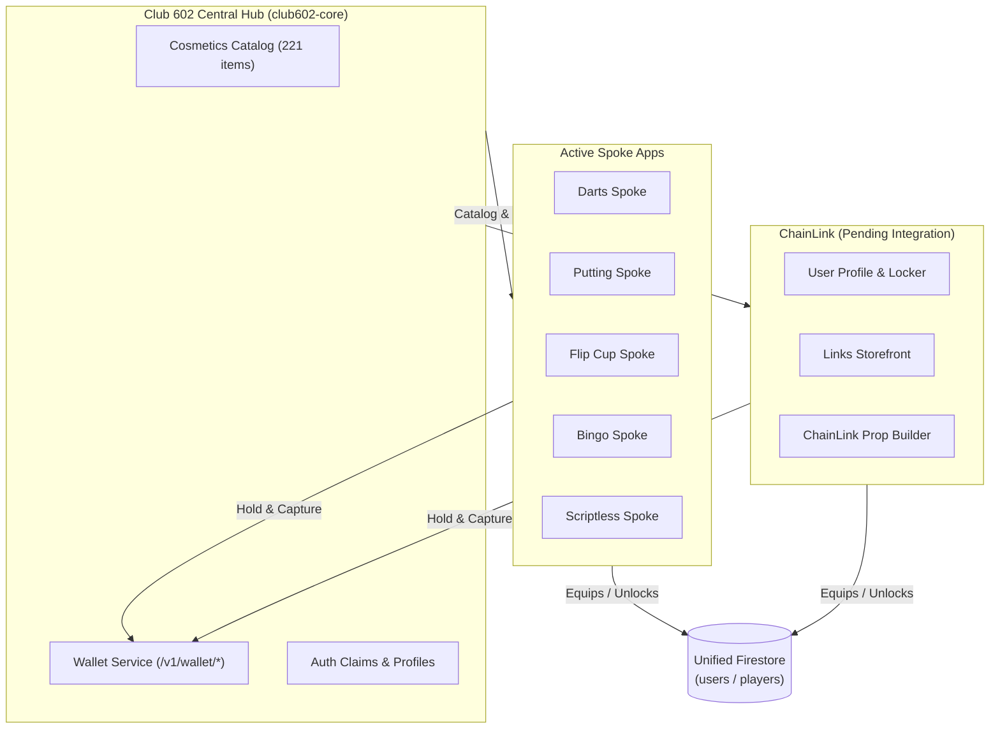
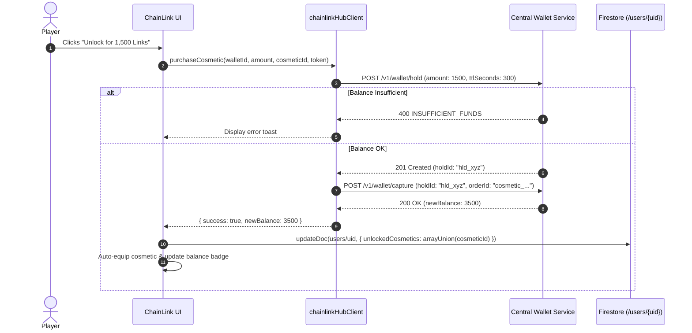

# 🅿️ ChainLink Master Parking Lot & 602 Core Integration Roadmap

**Document Version:** 2.0.0  
**Last Updated:** November 19, 2026  
**Status:** Authoritative Architectural Blueprint & Deferred Item Repository  
**Target Repository:** `KingofLakemoor/chainlink`  
**Authoritative Core:** `club602-core` (`@club602/cosmetics`, Links Central Wallet Service)  
**Related Repositories:**
- **Open-Source Base / Upstream:** `unmonk/chainlink` (Public upstream reference)
- **Production ChainLink Deployment:** `KingofLakemoor/chainlink`
- **Central Core & Cosmetics Authority:** `KingofLakemoor/club602-core`

---

## 1. Executive Summary & Context

ChainLink originated as an open-source sports streak and pick 'em game created by unmonk (`unmonk/chainlink`). As Club 602 expanded into grassroots local leagues (Darts, Putting, Flip Cup, Scriptless, Bingo, Gridiron Exotics), ChainLink was evolved into **ChainLink 2.0**—a comprehensive social prediction engine and rewards hub.

Across previous milestones in the Club 602 core ecosystem, the spoke applications (`darts`, `putting`, `flip`, `bingo`, `scriptless`) were unified around:
1. **A Canonical Cosmetics Catalog** (221 items across all spokes).
2. **Cross-Spoke Unlock Resolution & Equipping**.
3. **Live Virtual Currency (`Links`) Debit Flows** via the two-phase hold & capture wallet engine (`/v1/wallet/*`).

This **Master Parking Lot** serves as the single source of truth for:
- Features, benefits, and ideas temporarily parked, paused, or deferred for future implementation.
- Architectural boundaries separating open-source foundation from proprietary Club 602 IP.
- Full data contracts, schemas, and sequence flows for integrating ChainLink into the 602 Core ecosystem.
- Step-by-step implementation checklist.

---

## 2. Parked & Deferred Features Repository

### 2.1 Monthly Pro Set (ChainLink Pro Benefit)
* **Description:** A special Pro-only cosmetic set (exclusive monthly avatar ring, banner, or title) awarded to active ChainLink Pro subscribers every month.
* **Date Parked:** October 2026
* **Former UI Locations:**
  - `src/pages/help/HelpPage.tsx` under "ChainLink Pro Benefits": `<li><strong>Monthly Pro Set:</strong> Receive a special Pro Only cosmetic set every month.</li>`
  - `src/pages/shop/ShopPage.tsx` under "ChainLink Pro" subscription modal: `<li>A special <strong>Pro Only cosmetic set</strong> every month</li>`
* **Reason / Status:** Temporarily removed from the Pro benefits display while automated monthly recurring cosmetic distribution logic, Cloud Tasks/Cron workers, and recurring asset drops are finalized. To be re-added to `/help` and `/shop` upon completion of Section 6.

### 2.2 Central 602 Links Wallet Integration (`/v1/wallet/*`)
* **Description:** Replacing standalone simulated Links point updates with the two-phase hold/capture wallet service hosted by `club602-core`.
* **Date Parked:** November 2026
* **Target UI Locations:**
  - `src/components/UserHeaderBar.tsx` / `TopStats.tsx` (live Links balance badge)
  - `src/pages/shop/ShopPage.tsx` (purchases and locker unlocks)
* **Reason / Status:** Parked awaiting contract finalization and shared client helper implementation.

### 2.3 Cross-Spoke Cosmetics Locker & Scope Switcher
* **Description:** Unified locker modal enabling players to equip cosmetics globally across all Club 602 spokes or scoped specifically to ChainLink (`spokeCosmetics.chainlink`).
* **Date Parked:** November 2026
* **Target UI Locations:**
  - User Settings / Locker modal
  - Profile customization drawer
* **Reason / Status:** Parked until `@club602/cosmetics` catalog and resolver are connected into ChainLink.

---

## 3. Open-Source Separation & IP Boundary Specification

To maintain clean repository hygiene between open-source generic streak mechanics and proprietary Club 602 assets:



### 3.1 Functional Boundary Matrix

| Functional Area | Open-Source Component (Permissible to share/open) | Proprietary / Private Component (Club 602 IP) |
| :--- | :--- | :--- |
| **Pick 'Em Engine** | Standard matchup cards, head-to-head picks, basic streak counters (current streak, longest streak). | Grassroots multi-spoke prop ingestors, custom metric settlement, 1v1 and multi-way/field bet schemas. |
| **Sports Ingestion** | Generic public schedule polling (e.g. ESPN, public APIs) with open schemas. | Apify scraping actors, SharpAPI fallback proxies, automated custom bookmaker oddsmakers. |
| **Authentication & Users** | Generic Clerk / Firebase Auth starter implementations. | Club 602 unified profile sync (`users/{uid}`), Founder/VIP tier entitlements, multi-tenant role resolution. |
| **Economy & Currency** | Read-only simulated streak points or local scores. | **Links Currency**: Centralized hold-and-capture wallet service (`/v1/wallet/hold`, `/v1/wallet/capture`), transactional ledger, fraud limits. |
| **Cosmetics & Rewards** | Generic SVG icons or default avatar frames. | **Club 602 Cosmetic System**: `@club602/cosmetics` 221-item catalog, gradient titles, milestone unlocks, spoke-override resolvers (`spokeCosmetics.chainlink`). |
| **League Integrations** | Public pro sports leagues (NFL, NBA, MLB, NHL, EPL, World Cup). | Club 602 grassroot leagues (Putting League, Darts League, Flip Cup, Scriptless, Gridiron Exotics). |

### 3.2 Target Directory Organization

```
chainlink/
├── src/
│   ├── components/
│   │   ├── ui/                    # [OPEN] Generic UI elements (button, dialog, card, etc.)
│   │   ├── pickem/                # [OPEN] Standard pick 'em cards, matchup views
│   │   └── club602/               # [PRIVATE] Custom Club 602 avatar frames, badges, banners
│   ├── core/                      # [OPEN] Core streak calculations, daisy chain algorithms
│   ├── integrations/
│   │   ├── public/                # [OPEN] Generic ESPN / sports providers
│   │   └── club602/               # [PRIVATE] Webhook receivers, spoke prop syncing
│   ├── services/
│   │   ├── wallet/                # [PRIVATE] Links wallet client, 2-phase hold/capture
│   │   └── cosmetics/             # [PRIVATE] Unlocks resolver, shop purchase client
│   └── types/
│       ├── open.ts                # [OPEN] Generic Matchup, Pick, Streak definitions
│       └── club602.ts             # [PRIVATE] Spoke schemas, wallet contracts, cosmetic tokens
```

---

## 4. 602 Core Architecture & Data Contracts



### 4.1 Canonical Cosmetic Categories (`CosmeticCategory`)

| Category Key | Slot Type | Example Items | Render Mechanism |
| :--- | :--- | :--- | :--- |
| `TITLE` | Subtitle under username | *"Big League"*, *"Anchor"*, *"Championship Ring"* | Standard typography with rarity badge |
| `NAME_GRADIENT` | CSS Gradient for Username | *"Viper Neon"*, *"Golden Bull"*, *"Toxic Cyber"* | `text-transparent bg-clip-text bg-gradient-to-r` |
| `BADGE` | Pin / Emblem icon beside handle | `badge_bullseye`, `badge_hole_in_one`, `badge_bingo_champion` | Lucide icon or SVG asset |
| `AVATAR_RING` | Profile picture frame / animated border | *"Zenitho Ring"*, *"Inferno Frame"*, *"Emerald Ring"* | CSS border classes or `<Club602Avatar>` canvas |
| `PROFILE_BANNER` | Hero background card | *"Inferno Banner"*, *"Midnight Club"*, *"Retro Synth"* | CSS / SVG gradient banner container |
| `ROSTER_BANNER` | Matchup / Team backdrop | *"Team Apex"*, *"Neon Alley"* | Lineup card backdrop |

### 4.2 Unified Firestore User Profile Schema (`users/{uid}`)

```typescript
export type CosmeticCategory = 
  | 'TITLE'
  | 'AVATAR_RING'
  | 'BADGE'
  | 'NAME_GRADIENT'
  | 'PROFILE_BANNER'
  | 'ROSTER_BANNER';

export interface Club602UserProfile {
  uid: string;
  name: string;
  email?: string;
  photoURL?: string;
  membershipTier?: 'STANDARD' | 'PRO' | 'VIP_FOUNDER';

  /** Unlocked cosmetic item IDs owned by the user (cross-spoke) */
  unlockedCosmetics: string[];

  /** Legacy inventory field (supported as automatic fallback) */
  inventory?: string[];

  /** Global equipped cosmetics across all Club 602 applications */
  equippedCosmetics?: {
    TITLE?: string | null;
    AVATAR_RING?: string | null;
    BADGE?: string | null;
    NAME_GRADIENT?: string | null;
    PROFILE_BANNER?: string | null;
    ROSTER_BANNER?: string | null;
  };

  /** Spoke-specific cosmetic overrides */
  spokeCosmetics?: {
    chainlink?: Partial<Record<CosmeticCategory, string | null>>;
    darts?: Partial<Record<CosmeticCategory, string | null>>;
    putting?: Partial<Record<CosmeticCategory, string | null>>;
    flip?: Partial<Record<CosmeticCategory, string | null>>;
    bingo?: Partial<Record<CosmeticCategory, string | null>>;
    scriptless?: Partial<Record<CosmeticCategory, string | null>>;
  };

  /** Legacy flat fields maintained for backwards-compatibility */
  title?: string;
  avatarFrame?: string;
  badge?: string;
  nameGradient?: string;
  profileBanner?: string;
}
```

### 4.3 Scope Resolution Hierarchy

When rendering a user's cosmetic in ChainLink:
1. `spokeCosmetics.chainlink[SLOT]` (if set, overrides global for ChainLink)
2. `equippedCosmetics[SLOT]` (global default across all 602 spokes)
3. Legacy flat field (e.g. `user.title`, `user.avatarFrame`)
4. System Default (e.g. standard avatar, white name)

### 4.4 Unlocks & Ownership Resolution Algorithm

```typescript
import {
  COSMETICS_CATALOG,
  isCosmeticUnlocked,
  getCosmeticUnlockRequirement,
  isCosmeticPurchasable,
  getCosmeticCost,
  getUserUnlockedCosmetics,
  resolveSpokeCosmetics
} from '@club602/cosmetics';
```

#### Unlock Rules:
- **Free / Base Items**: Any item with `cost === 0 && rarity === 'common' && !unlockedByMilestone` is automatically unlocked for all players.
- **VIP / Founder Bypass**: If `user.membershipTier === 'VIP_FOUNDER'`, all cosmetics are available to equip.
- **Owned Items**: Included in `user.unlockedCosmetics` or `user.inventory`.
- **Equipped Fallback**: If an item is already equipped on the user document, it is grandfathered as unlocked.
- **Locked Items**: Render with `🔒` and user-facing requirements (e.g. *"Exclusive Darts League Achievement"* or *"Available for 1,500 Links in the 602 Shop"*).

---

## 5. Direct Links Purchase Flow (`/v1/wallet/*`)

When a player unlocks a purchasable cosmetic directly in ChainLink with Links:



---

## 6. Implementation Checklist & Next Steps

### Phase 1: Core Dependency & Contract Setup
- [ ] **Package Dependency**: Add `@club602/cosmetics` dependency or vendor components from `club602-core/packages/cosmetics`.
- [ ] **Lockfile Sync**: Run `npm install` and verify `npm ci` passing cleanly per `AGENTS.md`.
- [ ] **Mock Mode Guard**: Provide fallback mock implementations of `WalletService` and `CosmeticsCatalog` when central service keys are absent.

### Phase 2: User Interface & Navigation Integration
- [ ] **Top Navigation Bar**: Display live Links wallet balance badge and active avatar ring / title / gradient in `UserHeaderBar.tsx` / `TopStats.tsx`.
- [ ] **Locker / Customization Modal**:
  - Implement slot dropdowns for Title, Avatar Frame, Badge, Name Gradient, and Profile Banner.
  - Implement Lock indicator (`🔒`) and requirement tooltips.
  - Add Scope Switcher (`🌐 Everywhere` vs `⛓️ ChainLink Only`).
  - Add in-modal direct Links purchase drawer.
- [ ] **Leaderboards & Roster Cards**: Render `<Club602Avatar>`, `<Club602Nameplate>`, and `<Club602Banner>` on user cards and leaderboards.

### Phase 3: Spoke Webhook & Prop Automation
- [ ] **Grassroots Webhook Ingestion**: Ensure `/api/webhooks/scriptless` and `/api/webhooks/putting` validate against unified central shared secrets.
- [ ] **Prop Builder Scoring**: Verify webhooks pushing props to `/api/chainlink/push-matchups` continue resolving match metrics seamlessly.

### Phase 4: Monthly Pro Drop Engine & Unparking
- [ ] **Automated Monthly Pro Drop**: Implement backend Cloud Task / scheduled job distributing exclusive monthly Pro items to active subscribers.
- [ ] **Unpark Monthly Pro Set**: Re-enable UI benefit mentions in `src/pages/help/HelpPage.tsx` and `src/pages/shop/ShopPage.tsx`.
- [ ] **License & Attribution Headers**: Ensure upstream attribution to `unmonk/chainlink` is preserved and proprietary headers are applied to Club 602 private modules.
